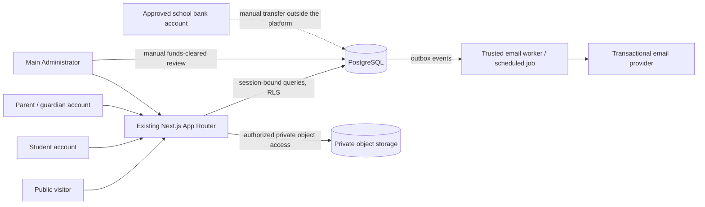
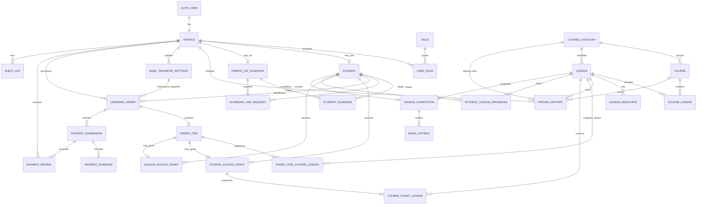
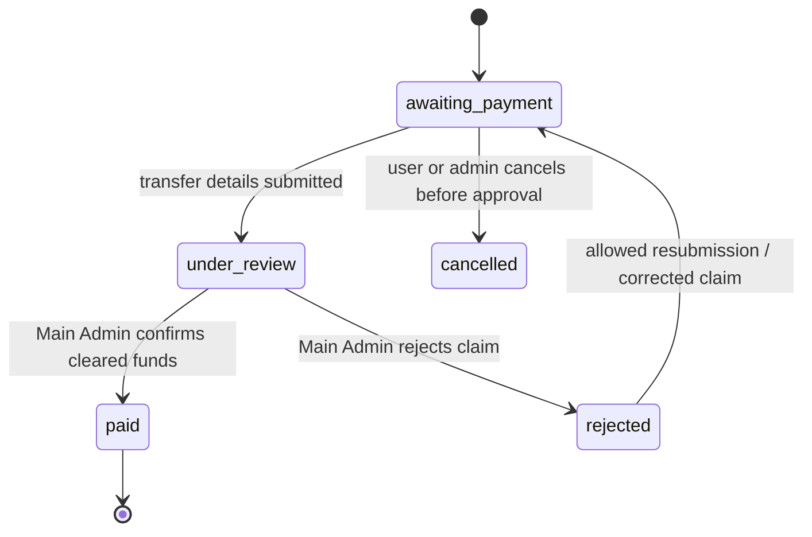

# Adebola College — Phase 2 System Architecture and Database Blueprint

**Status:** Design proposal only; not approved for implementation
**Scope:** Existing Next.js application and the confirmed public website, E-Learning, account, manual bank-transfer, and student-management requirements
**Important:** No application feature, dependency, database object, migration, or service configuration was changed or created for this document.

## 1. Executive recommendation

Continue the existing Next.js 14 App Router application. Use PostgreSQL as the system of record and Supabase as the leading managed-platform candidate for PostgreSQL, Auth, and private object storage. Use the existing Next.js server boundary for catalogue reads, protected lesson delivery, checkout, payment-review workflows, account linking, and email-event creation. Do not add a separate Express or NestJS service: no confirmed requirement justifies another backend.

Use the authenticated user's Supabase session for normal server-side data access, and PostgreSQL Row Level Security (RLS) as a second authorization boundary. Privileged operations must use narrow server-side functions/actions with explicit role and relationship checks. A Supabase service-role key, if required for a narrowly scoped internal task, must only exist in server-only configuration and must never be exposed to a browser.

The model distinguishes an account holder (Auth user/profile), a student record, and a guardian record. An order records both its payer and the student who receives access. Each payment decision and each access grant is attributable and auditable. Course purchases snapshot the course's lesson list at checkout so future course edits do not silently change a past entitlement.

This is a proposal, not a production-ready migration. Client decisions listed in §19 must be resolved before implementation.

## 2. Existing application and proposed stack

### Existing foundation

- Next.js `14.2.15`, React `18.2.0`, JavaScript, npm, and App Router.
- Existing public routes: `/`, `/about-us`, `/admissions`, `/academics`, `/student-life`, `/families`, `/e-learning`, and `/contact-us`.
- Shared header and footer; global CSS and the current page layout should be retained.
- No production database, authentication, admin, payment, storage, or email integration was found in the application source during Phase 1.
- The production build and all eight route smoke tests passed in Phase 1.

### Recommended components and trade-offs

| Concern | Recommendation | Trade-offs / conditions |
|---|---|---|
| Web application | Keep Next.js 14 App Router and React; add server components, route handlers, and server actions only where they fit established project conventions. | Keeps the design-first application and avoids a rewrite. Next.js 14.2.15 is the existing version; review its supported security updates and upgrade policy before production deployment. |
| Database | PostgreSQL, with Supabase Postgres as candidate. | Relational constraints and transactions fit orders, audit trails, guardianships, and access grants. Confirm region, backup, retention, cost, and operational ownership. |
| Authentication | Supabase Auth candidate, with verified email and server-managed sessions. | Avoids custom password storage and authentication protocol work. Define guardian/student registration, email verification, recovery, and consent before enabling self-service accounts. |
| Database client | Supabase JS plus `@supabase/ssr`-style server/browser separation, compatible with the App Router. | SSR cookie handling and session refresh must be implemented carefully. Browser clients may use the anon/publishable key only with RLS; privileged keys stay server-only. Confirm compatible package versions before installation. |
| Storage | Supabase Storage private buckets, or equivalent private object storage. | Suitable for lesson resources and evidence; private files need authorization and short-lived signed URLs. Do not serve private evidence from the public website or the Next.js filesystem. |
| Email | Transactional email provider called from a server-side outbox worker/job. Provider not selected. | Supports verification and operational notifications; requires sender-domain validation, retry handling, bounce monitoring, and data-processing review. |
| Hosting | Vercel is compatible with Next.js App Router; evaluate deployment there after confirming project ownership and database region. | Serverless request limits and temporary local disk make it unsuitable for durable uploads or long-running video processing. Keep large files in object storage and send email asynchronously. |
| Separate API server | Not recommended initially. | Adds deployment, authentication, and operational complexity without a demonstrated requirement. Revisit only if a concrete integration or workload exceeds Next.js/serverless boundaries. |

### Supabase session and access design

1. Supabase Auth authenticates the user. The browser receives only the public/anon client configuration and a session managed with secure cookies.
2. Server components/route handlers create a request-scoped Supabase server client that reads the session cookie. Session refresh is handled in the supported Next.js middleware/proxy integration for the chosen package versions.
3. User-scoped database calls run with the authenticated user's JWT so PostgreSQL RLS can evaluate `auth.uid()`. Do not trust a user ID, role, student ID, or price supplied only by the browser.
4. RLS protects exposed tables even if a route is called directly. The server independently checks role, student identity, guardian link, order state, and entitlement before returning protected data or mutating state.
5. Administrative approval and grant creation should be one atomic transaction in a narrowly scoped database function or trusted server transaction. Only the Main Administrator can request that action; the server verifies this role before invoking it.
6. If a service-role key is necessary for Auth administration or a background process, keep it in server-only environment variables, limit its use, log its privileged actions, and do not pass it to client components.
7. Prefer a transactional outbox for email and idempotent background processing. A page request should not be the only mechanism responsible for reliable email delivery.

## 3. System boundaries and data flow



The bank is not integrated with the application. The administrator checks the bank account outside the platform and records an approval only after confirming cleared funds. No automatic bank reconciliation or gateway verification is proposed.

## 4. Entity relationship diagram



`AUTH_USER` is Supabase Auth's `auth.users` table and is not recreated. The diagram omits some audit and status fields for readability.

## 5. Proposed normalized data model

The detailed SQL proposal is in §17. All monetary values are integer **kobo** in NGN: `₦1 = 100 kobo`. Thus the proposed initial lesson prices are JSS `50,000` kobo, SSS `100,000` kobo, and Standardized Tests `150,000` kobo. Display amounts by dividing by 100 and formatting as NGN; never use floating-point currency arithmetic. Course prices are separate and must be supplied/configured by the administrator.

| Table | Purpose and key relationships |
|---|---|
| `profiles` | One profile per `auth.users` identity; stores only account-level display/contact metadata, not passwords. |
| `roles`, `user_roles` | Controlled role assignments: `student`, `parent_guardian`, `main_admin`, and `sub_admin`. Self-service users cannot assign or elevate roles; Guest access is not an administrative role. |
| `admin_permissions`, `admin_user_permissions` | Main-Admin-managed, granular Sub-Admin module/action grants, with enable/disable state and audited grant/revocation history. A server operation and RLS enforce assignments; browser navigation is not an authorization boundary. |
| `students` | Student identity and status; optionally linked to a student Auth profile. Parent-created student records can exist before a student login is created. |
| `parents_or_guardians` | Guardian identity linked one-to-one with an account profile. |
| `student_guardians` | Many-to-many, explicit, status-bearing authorization relationship; permits multiple authorized guardians and multiple children. |
| `guardian_link_requests` | Expiring, one-time, hashed-token invitation/approval workflow; never use an unverified email match as authorization. |
| `course_categories` | Fixed initial catalogue categories: `jss`, `sss`, `standardized-tests`; names and display order are editable content. |
| `courses`, `lessons` | Published/unpublished course and lesson metadata, descriptions, codes, category assignment, and optional video reference. |
| `course_lessons` | Course contents and ordering; a lesson may be in multiple courses only if explicitly approved. |
| `lesson_resources` | Private object key or approved external resource reference, display name, type, and publication state. |
| `pricing_history` | Effective-dated category lesson defaults, lesson overrides, and course prices. Order lines store the price snapshot so later edits do not change past purchases. |
| `bank_transfer_settings` | Versioned approved transfer instructions, including bank/account details, active state, update time, and the responsible administrator. Never seed or hardcode account details in source. |
| `learning_orders`, `order_items` | One purchaser and one student beneficiary per order; each item snapshots product name, type, and unit/line price. |
| `order_item_course_lessons` | Checkout-time snapshot of all course lessons, their individual-price weights, and which lessons the beneficiary already owned. Supports auditable remaining-lessons course pricing and prevents future course edits changing the historical deal. |
| `payment_submissions`, `payment_evidence`, `payment_reviews` | Transfer claims, private evidence references, and append-only administrator decisions. A rejected transfer can be resubmitted without erasing its history. |
| `course_access_grants`, `course_grant_lessons`, `lesson_access_grants` | Student-specific access sourced from an approved order item; course grants include a snapshot of covered lessons. Revocation is recorded, not deleted. |
| `student_lesson_progress`, `lesson_completions` | Current progress plus one durable completion record per student/lesson. |
| `email_outbox` | Idempotent notification work, recipient, retry count, and delivery status; does not contain evidence files. |
| `audit_log` | Append-only record of sensitive administrative and payment/access actions. |

### Important integrity and indexing rules

- Auth profile IDs, student IDs, guardian IDs, order IDs, and catalogue IDs are UUIDs; timestamps are `timestamptz`.
- Enforce `UNIQUE` for Auth profile linkage, category slug, lesson code, course slug, one student/lesson progress row, one completion per student/lesson, and each grant's source order item.
- Monetary amount, quantity, evidence size, progress range, and status values have database checks as well as server validation.
- `learning_orders` identifies the authenticated purchaser separately from the beneficiary student. Guardian checkout is valid only for a currently active linked child. Student checkout is valid only for that student's own linked student record.
- A course `order_item` snapshots its included lesson IDs when created. On approval, a course grant and its covered lesson set are created in the same transaction as the payment decision.
- Duplicate or overlapping purchases must be checked server-side before order creation. Existing valid course access suppresses a lesson charge; existing lesson access suppresses a duplicate lesson line. A new course is not charged for lesson content already accessible through another grant unless the business rule explicitly changes.
- Recommended course-overlap rule, subject to client approval: calculate a remaining-lessons price. At checkout, snapshot the complete course lesson set and the current individual lesson-price weight for each lesson. Exclude lessons already accessible to the beneficiary from the payable set; calculate `course_price_snapshot_kobo × remaining_weight / total_weight`, using exact decimal/integer arithmetic and a documented deterministic kobo-rounding rule. Snapshot weights, owned/unowned flags, original course price, and final payable price in the order. The server alone calculates the amount. If all lessons are already accessible, do not create or charge an order; show that the course content is already covered. If a course has no lessons or zero total weight, block checkout and surface an admin catalogue correction. Client approval is required for this model and rounding rule.
- Recommended entitlement duration, subject to client approval: access does not expire automatically; a nullable `expires_at` remains `NULL` for indefinite access and a separately authorized revocation is still possible. If the client selects a fixed access period, snapshot the expiry on the grant at approval so later policy changes do not rewrite existing access.
- Keep approved/rejected payment reviews and grant history. Revocation is a status/timestamped event with an actor/reason, not deletion. Refund handling remains a documented manual/future policy; no automated refund feature is designed here.
- Suggested indexes: foreign-key columns; `(category_id, published, display_order)` on courses/lessons; `(student_id, status)` on grants; `(beneficiary_student_id, created_at)` on orders; `(order_id, status)` on submissions; `(status, created_at)` on outbox; `(actor_profile_id, created_at)` on audit log.
- For effective-dated pricing, allow one current row per target/scope with a partial unique index and update old `effective_to` plus insert the new row in one transaction. If strict non-overlap is required, add an exclusion constraint after confirming extension availability or enforce it in the transaction.

## 6. Parent/guardian and student account design

### Identity separation

- Every login belongs to one Auth user and one `profiles` row.
- A user may have a student role, a parent/guardian role, or both only if the client approves that real-world case. A guardian's profile is not the student's profile.
- `students` is the learning identity/beneficiary. It can be created by an eligible guardian or the Main Administrator before the student has login credentials; the nullable unique account link allows later activation.
- `parents_or_guardians` is the guardian identity. `student_guardians` is the explicit authorization link and carries status, relationship label if approved, consent/verification timestamps, and who established the link.
- Orders always name the beneficiary student. The payer is separately recorded as the profile that created the order. The student owns learning progress and entitlement.

### Safe onboarding and linking proposal

1. **Parent-created student profile:** a verified guardian submits the minimum necessary child details. This creates a pending student profile and a pending guardian relationship; it does not create an Auth user, password, login credentials, or active student login. The guardian relationship is activated only after approved consent/authority verification. The student profile may be used as an order beneficiary only if client policy explicitly permits guardian-managed purchases before the student account exists.
2. **Independent student account:** the student registers through Auth using their own verified email, completes minimum profile fields, and receives a distinct student record linked to that Auth profile after identity/duplicate checks. The account is active only after email verification and any required age/guardian-consent checks. The age/consent policy requires client approval.
3. **Verified student account linked to a guardian:** the guardian submits a one-time, expiring link request to a verified student account. The student accepts through their authenticated session, or the Main Administrator verifies authority under the approved evidence process. Only then is the `student_guardians` relationship activated. A link request is not itself access.
4. **Existing student profile later receives an account:** the student independently registers and verifies their email, then requests association with the existing pending profile. The Main Administrator or approved matching workflow confirms identity before attaching the unique `profile_id`. Never auto-link based only on matching names, date of birth, or an unverified email.
5. **Duplicate prevention:** before creating a student, the server searches for existing profiles using exact verified account linkage and any client-approved minimum identity fields. Normalize data only for duplicate detection, not to silently merge records. If a possible duplicate is found, block automatic creation and route it to a restricted Main Administrator resolution queue. Record merge/link decisions in the audit log; preserve the surviving student ID and all purchase/progress history. Client must approve the identifiers used because collecting more data increases privacy risk.
6. **Invitations:** generate a cryptographically random, single-use token; store only its digest; set an expiry; bind it to a specific guardian/student/action; rate-limit requests; and require the intended verified account to accept. Do not send child details in invitation links or expose whether a target account exists.
7. **Multiple children/guardians:** each child has a separate student record and relationship row. Every guardian sees only active linked children. Additional guardians must independently accept or be verified; revocation blocks subsequent access and leaves an audit record.
8. **Activation and recovery:** Auth account activation follows verified email and approved consent/link checks. Parent-created student records never receive generated passwords or credentials. Student and guardian account recovery uses provider-managed, verified, non-enumerating recovery; support/admin must not disclose another account's existence or issue a password. Re-linking after revocation requires a new invitation and verification.

Store only necessary child data. Do not request academic records, attendance, or results for this E-Learning system. Define guardian consent, age threshold, consent evidence, and data-retention/deletion rules with the client and applicable privacy counsel.

## 7. Purchase, pricing, and manual bank-transfer workflow

### Individual lesson

1. Authenticated student or linked guardian chooses a published lesson and a beneficiary student.
2. Server verifies identity, active guardian link if applicable, publication, current entitlement, and current price.
3. Server creates an order and lesson order line with integer-kobo price snapshot. The client cannot choose the amount.
4. Page displays the active client-approved bank instructions and order reference. The server associates the exact immutable settings version with the order; only authenticated eligible students/guardians can view the instructions for that order.
5. Payer submits transfer reference/date/amount and any required proof. Evidence is stored privately; the submission is `submitted`/`under_review`.
6. Main Administrator checks the actual account outside the website. A claim alone is not proof of cleared funds.
7. Admin records an approved or rejected decision with reason and time. Only an approved decision creates the lesson grant, atomically, for the order's beneficiary.
8. Rejection notifies payer and allows a new submission according to an approved retry policy; prior submission and review remain auditable.

### Complete course

The same flow applies, but the order line records the independent course price and snapshots current course lesson membership. **Recommended overlap rule (requires client approval):** calculate a remaining-lessons price, rather than charge the full course price when some lessons are already owned. Snapshot the course price and current per-lesson price weights. Compute the payable amount as the course price multiplied by the ratio of unowned lesson weights to all lesson weights, using exact decimal/integer arithmetic and a client-approved deterministic rounding rule to kobo. Snapshot each included lesson, weight, and entitlement-at-checkout flag. The server calculates and persists the final amount; browser-supplied prices are ignored. On approval, grant only the lessons not already entitled at checkout; existing valid grants remain the access source for owned lessons. If all lessons are already owned, show that no purchase is needed and create no order. Block course checkout if the course is empty or has no usable price weights. This recommendation avoids duplicate charges but changes how standalone course price is applied and must be approved.

### Bank-transfer settings

Store bank instructions as versioned `bank_transfer_settings` records: bank name, account name, account number, transfer instructions, active status, `updated_at`, and `updated_by` (the Main Administrator profile). Treat each record's bank details/instructions as immutable; a change creates a new version, marks the previous version inactive, and activates the replacement atomically. Enforce at most one active record. Only the Main Administrator may create, edit, activate, or deactivate settings; each change is audited. Students and parents may read the approved active instructions only after authentication, and should see the exact instructions version associated with their order. Orders must not be created for bank transfer if no active approved setting exists. Do not include bank details in source code, environment examples, this document, or public catalogue pages. No bank details are supplied or invented here. The order's foreign key to the immutable settings version preserves the instructions shown to a payer if details later change.

### Statuses and duplicate controls

- Order: `awaiting_payment`, `under_review`, `paid`, `rejected`, `cancelled`.
- Submission: `submitted`, `under_review`, `approved`, `rejected`, `withdrawn`, `duplicate`.
- Review decision: `approved` or `rejected`, actor must hold `main_admin`.
- Only one final approval per order; approval requires submitted amount and order total to match, unless an explicitly approved split/overpayment policy exists.
- Require idempotency on order creation/submission endpoints. A duplicate bank reference or matching evidence is flagged for admin review; it is not automatically accepted.
- A pending claim grants no access. Rejected, cancelled, or duplicate submissions grant no access.
- Course/lesson access is revoked only through a separately authorized and audited action. Define treatment of refunds, chargebacks, corrections, and mistaken approvals before launch; no gateway or automated refund is in scope.



Payment approval transaction: lock the order/submission; assert a verified Main Administrator; assert the order has not already been approved; append the review and audit records; mark submission/order approved/paid; insert grant(s) for the recorded beneficiary and order item; enqueue appropriate notifications; commit. Any failure rolls the entire transaction back.

## 8. Course access and authorization matrix

Every check runs on the server and is backed by RLS. Hiding a button or route is not authorization. Resolve a student from the authenticated account or a verified guardian-child link; ignore a client-supplied beneficiary ID unless it is validated against that relationship.

| Resource/action | Public visitor | Student | Linked guardian | Main Administrator |
|---|---:|---:|---:|---:|
| View published catalogue, descriptions, prices | Yes | Yes | Yes | Yes |
| View unpublished lessons/resources | No | No | No | Yes |
| View own profile/progress | No | Own only | No | Yes, for E-Learning support |
| View linked student's E-Learning profile/progress | No | No | Linked children only, minimum required data | Yes |
| Access lesson media/resource | No | Active individual grant or course grant covering that lesson | Only through an explicitly supported child-view flow; preferably child session only | Yes for support/admin purpose |
| Create order for student | No | Own student identity only | Active linked child only | No routine purchase as another user |
| Submit transfer claim | No | Own order only | Order they created for linked child only | No |
| View active bank-transfer instructions | No | Authenticated student checkout/order only | Authenticated linked-child checkout/order only | Yes |
| Create/edit/activate bank-transfer settings | No | No | No | Yes; each change audited |
| Approve/reject payment | No | No | No | Main Administrator only |
| Create/revoke access | No | No | No | Main Administrator; payment approval creates grants transactionally |
| Create/edit/publish catalogue | No | No | No | Main Administrator |
| Assign roles / suspend accounts | No | No | No | Main Administrator, audited |

If guardian-mediated lesson viewing is later required, define a dedicated delegated-access policy and audit it; do not make a guardian's login impersonate the child's account.

**Lesson entitlement predicate:** authenticated student ID matches the target student, student and account are active, lesson is published, and either an active `lesson_access_grant` exists or an active `course_access_grant` has a `course_grant_lessons` row for that lesson; each qualifying grant must also have `expires_at IS NULL OR expires_at > now()`. An admin override must be explicit, time-bounded if appropriate, reasoned, and auditable.

## 9. Roles and permissions

| Capability | Student | Parent/guardian | Main Administrator |
|---|---:|---:|---:|
| Manage own account and recovery | Yes | Yes | Administrative support only |
| Link or manage a student relationship | No | Request/link only through verified flow | Verify, activate, suspend, or revoke with audit |
| Browse published catalogue | Yes | Yes | Yes |
| Purchase for beneficiary | Own student only | Active linked children only | Not a normal administrator action |
| Submit payment evidence | Own order only | Own order for linked child only | No |
| View purchases/payment status | Own | Orders they created for linked children | All E-Learning transactions |
| Review and approve/reject payment | No | No | Yes; sole approver |
| Manage courses, lessons, codes, resources, videos, prices, publishing | No | No | Yes |
| Manage course access and account status | No | No | Yes |
| View E-Learning activity | Own | Linked children only | Yes, for defined support/operations |

No Instructor Admin role is proposed. If multiple administrators are later needed, define their authority and a two-person payment-review policy explicitly; the present requirement assigns payment approval to the Main Administrator alone.

## 10. Lesson completion and email design

### Completion proposal

Initial low-complexity mechanism: an authenticated student with a valid, unexpired lesson entitlement presses **Mark lesson complete** after viewing the lesson/resource. The server rechecks the entitlement and inserts one completion record for `(student_id, lesson_id)`; a unique constraint prevents duplicate completion. The first accepted completion timestamp is retained. Progress percentage may be omitted initially or stored separately for optional video progress; it is not proof of completion.

This manual attestation is the proposed baseline, not a confirmed client rule. Video-progress completion (for example, a provider-reported watch threshold) is an alternative requiring client approval and a technically trustworthy video-provider event; client-side percentage reports alone must not qualify. Ask whether resource lessons use the same manual completion action. Do not add quizzes or certificates.

### Access duration

The access-expiry policy is not specified in the supplied requirements. Recommendation for the initial design: purchased lesson/course access remains available indefinitely unless revoked through an authorized, audited action. Add nullable `expires_at` to access grants; `NULL` means no automatic expiry. If the client chooses fixed-duration access, define the duration before checkout and snapshot the resulting expiry on each grant at approval. Do not infer expiry from payment date or change historical grants when pricing/access policy changes.

### Recipient and delivery matrix

| Event | Student | Guardian | School/admin |
|---|---|---|---|
| Registration verification/recovery | Account email | Guardian account email | No routine notification |
| Payment claim received | Payer acknowledgement; student receives status if different and approved by policy | Payer acknowledgement; linked student gets a status notification only if approved | E-Learning operations mailbox may receive a minimal review alert |
| Payment approved/rejected | Beneficiary student and payer as appropriate; no evidence attachment | Payer and linked student as permitted by consent/preferences | E-Learning operations mailbox may receive status |
| Course access granted | Beneficiary student | Payer/guardian as permitted | No routine notice |
| Lesson completion | Student's verified email | Optional linked guardian notice only with explicit policy/consent | No routine notification |

Proposed school operational recipient for E-Learning events: `e-learning@adebolacollege.org`; `adebolacollege@gmail.com` may be a monitored fallback only if the client confirms its use and access controls. Public-school contact candidates supplied are `contactus@adebolacollege.org` and a Gmail address whose intended spelling is ambiguous in the supplied text; confirm the exact address before using it. Configure a separate verified sender address/domain; do not assume these recipient addresses are authorized senders.

### Reliability and privacy

- **Outbox responsibility:** the application transaction creates a durable notification event and a safe payload/recipient reference; that database row does not send an email by itself.
- **Worker responsibility:** a trusted background worker or scheduled job polls/claims due outbox rows atomically, resolves and validates the intended recipient from trusted profile/relationship records, renders an approved template, calls the transactional email provider, and records the provider message ID, attempt time, result, and next retry time. It must not accept an arbitrary destination address from a browser request.
- **Provider responsibility:** the provider accepts the authenticated send request, applies the verified sender/domain and delivery infrastructure, reports accepted/rejected delivery status, and optionally delivers bounce/complaint webhooks. It does not decide recipients, authorize student data, approve payments, or guarantee inbox delivery. Verify sender domain and webhook signatures; store only minimal provider status.
- **Retries and duplicate prevention:** use an idempotency key unique per event/recipient, atomic worker claiming/lease or equivalent, and provider idempotency support where available. Retry transient errors with bounded exponential backoff and jitter; do not retry permanent invalid-recipient/template errors indefinitely. A completion, payment approval, or grant must not produce duplicate logical notices when a worker crashes after provider acceptance.
- **Failure monitoring:** alert an operator when rows exceed retry thresholds or enter terminal failure; expose queue age, failure counts, and provider rejection/bounce signals in an admin operational view or monitoring system. Provide an audited manual retry/dead-letter resolution procedure. Never silently mark a failed send as delivered.
- Select recipients only from verified account emails and current relationship/consent preferences: student for student events; payer and beneficiary only under the approved payment-notice policy; linked guardian only when policy/consent permits. Revalidate relationship and account status at send time. Keep payment evidence and sensitive account information out of messages.
- Never include bank account numbers, transfer evidence, signed storage URLs, passwords, or unnecessary child data in email. Use authenticated dashboard links for sensitive details.
- Confirm student/guardian recipient preferences, legal basis/consent, and school mailbox ownership before sending.

## 11. Security and privacy plan

### Authorization and RLS

- Enable RLS on **every table exposed through Supabase's Data API**, not only user-facing tables. Maintain a reviewed table-by-table policy inventory and default-deny posture; add narrowly scoped `SELECT`/`INSERT`/`UPDATE` policies only after defining ownership and state transitions. Internal tables must either have RLS enabled with no client policies or be explicitly excluded from API exposure and have table privileges revoked.
- Keep role assignments, audit logs, payment reviews, and access grants immutable to student/guardian clients. Do not allow direct browser writes to approval or role tables.
- Use server-side transactions for stateful operations. RLS is necessary but does not replace route/action authorization or business-rule validation.
- Avoid broad `SECURITY DEFINER` functions. If needed, use a dedicated non-login owner, fixed `search_path`, fully qualified object names, minimal arguments, explicit role checks, and restricted `EXECUTE` grants.
- Never trust role claims or IDs submitted from the browser. Refresh role checks from protected database records for privileged actions.
- Bootstrap the first Main Administrator through a documented, one-time, trusted operator procedure (for example, controlled Auth-user creation followed by a reviewed database role assignment); disable/remove the bootstrap mechanism immediately afterward. Never expose admin signup, seed a production password, allow a user to grant themselves a role, or rely on a client-editable profile field as authority. Record the bootstrap actor/time and test recovery without weakening authorization.
- Payment approval and access grant creation must be one atomic, idempotent server/database transaction. Lock the relevant order and submission, re-check Main Administrator authority and funds-cleared confirmation, validate order state and exact amount, append the decision/audit record, create only the grants matching approved item snapshots and beneficiary, and enqueue notifications before commit. Any failure rolls the entire operation back.
- Validate purchaser and beneficiary relationships server-side on every order creation and submission: student purchaser must map to that same active student; guardian purchaser must have an active verified link to the beneficiary; all accounts must meet the approved active/consent policy. Never authorize from a posted `student_id` alone.
- Prevent price manipulation by deriving current lesson/course prices and overlap calculations on the server from effective-dated pricing and entitlement data. Ignore client-submitted unit prices, discounts, totals, lesson weights, and owned flags. Snapshot the calculated values in an atomic order-creation transaction and reject client attempts to mutate order lines or totals afterward.
- Maintain explicit private storage policies for every bucket/object path. Buckets for paid lessons and payment evidence must be private; enforce both database row authorization and object-path ownership/entitlement rules, issue short-lived signed URLs only after server authorization, and test that guessed object keys cannot be read.
- Required authorization tests must include cross-student and cross-family access attempts using direct HTTP/API/database calls: unrelated student reads another student's profile, progress, order, evidence, and lesson resources; guardian reads an unlinked child's data; guardian's link is revoked while a session remains active; student changes IDs/roles/prices/beneficiary in requests; and suspended/expired accounts attempt access. Every unauthorized request must be denied without leaking whether protected records exist.

### Authentication and account isolation

- Use provider-managed password hashing; never store or log passwords or recovery tokens.
- Require verified email; secure cookies, HTTPS, appropriate same-site settings, short session lifetimes for admin use, and reauthentication for sensitive operations.
- Rate-limit registration, login, recovery, invitation, payment submission, and admin endpoints; use non-enumerating recovery responses.
- Student profile visibility is limited to the student's account, active guardians, and authorized admin support. Guardians see only actively linked children. Revoked links lose access immediately.
- Define guardian consent and age policy before accepting accounts for minors. Collect the minimum personal data necessary.
- Parent-created student records remain pending learning identities without Auth credentials. Activation as a login requires a separate student Auth registration, verified email, approved consent/age checks, and verified association to that record.

### Uploads and lesson resources

- Use private buckets separated by purpose (e.g. `lesson-resources` and `payment-evidence`) with non-guessable object keys.
- Validate file size/type server-side; distrust MIME supplied by the browser; scan files where a suitable service is selected; restrict executable/active content and dangerous document formats according to client needs.
- Store evidence metadata and storage keys, not public URLs. Authorize every read and issue a short-lived signed URL only after checking owner/admin permission.
- Do not allow user-submitted video URLs to become arbitrary server-side fetches. Validate allowed hosts/protocols to prevent SSRF if server fetching is ever added. Prefer storing a provider reference or controlled storage key.
- Deletion/retention must follow the approved evidence and learning-material retention policy; do not delete records needed for audit without an approved lawful retention process.

### Data integrity, operations, and child privacy

- Validate all fields, identifiers, amounts, statuses, and upload metadata on server and database boundaries.
- Log admin actions, relationship changes, payment decisions, price edits, publishing changes, access grants/revocations, and account suspension. Do not log secrets or file contents.
- Protect audit logs from client mutation; restrict viewing to the Main Administrator. Establish retention and export procedures.
- Define encrypted backups, restore tests, point-in-time recovery availability, recovery-point objective (RPO), and recovery-time objective (RTO) with the selected provider.
- Confirm hosting/database region and applicable privacy/data-protection obligations, guardian consent, lawful basis, data subject requests, and retention/deletion rules before collecting child data.
- Monitor auth, admin activity, failed upload access, repeated payment references, outbox failures, and unusual access patterns; define incident response ownership.

## 12. Proposed application routes

Existing public routes remain in place. These are route proposals, not created routes.

```text
/                              Home
/about-us                      About Us
/admissions                    Admissions
/academics                     Academics
/student-life                  Student Life
/families                      Families
/e-learning                    Public catalogue overview
/e-learning/[category]         JSS | SSS | Standardized Tests
/e-learning/[category]/[course] Course details
/e-learning/lessons/[lesson]   Public lesson description; protected resources separately
/contact-us                    Contact Us

/account/register              Account type and registration
/account/login                 Login
/account/verify                Email verification callback/status
/account/recover               Recovery request
/account/reset                 Password reset callback
/account/link/[token]          Invitation acceptance (one-time, expiring)

/dashboard                     Role-aware landing/redirect
/dashboard/student             Student dashboard
/dashboard/student/courses     Student's active course and lesson access
/dashboard/student/progress    Student's lesson activity/completions
/dashboard/guardian            Guardian dashboard
/dashboard/guardian/children  Linked children and link requests
/dashboard/guardian/orders     Orders placed by guardian for linked children

/checkout/lesson/[lesson]      Confirm beneficiary and create lesson order
/checkout/course/[course]      Confirm beneficiary and create course order
/orders/[order]                Order and bank-transfer instructions/status
/orders/[order]/payment        Submit transfer details/evidence

/admin                         Main Administrator landing
/admin/students                Student/guardian accounts and relationships
/admin/students/[student]      E-Learning profile, activity, purchases/access
/admin/courses                 Course catalogue management
/admin/courses/[course]        Edit course, lesson membership, publication
/admin/lessons                 Lesson management
/admin/lessons/[lesson]        Edit code, description, price, resources/video
/admin/pricing                 Effective-dated category/course/lesson prices
/admin/payments                Pending and historical payment submissions
/admin/payments/[submission]   Evidence review and recorded decision
/admin/settings/bank-transfer  Versioned bank instructions; Main Admin writes
/admin/access                  Grants, revocation, and audit history
```

Protect all `/dashboard` and `/admin` data at the server boundary. Middleware may improve redirects but must not be the only authorization check. Do not expose protected lesson resource bytes through a public page route.

## 13. Content and asset mapping

The client has identified materials supplied in the ChatGPT conversation: `AdebolaContents.docx`, entrance examination PDFs, E-Learning lesson PDFs/materials, the school logo, photographs, and other supplied assets. Those conversation attachments are the authoritative intake sources for content mapping; they need not also exist in the repository to be considered supplied. Their contents and rights/approval are not reproduced or inferred here. Phase 1 inspected the repository and did not find these named source files under the Adebola application directory. Do not conclude that the client has not supplied them, and do not substitute similarly named assets from other projects.

| Existing page | Required client material | Current state / mapping action |
|---|---|---|
| Home | Approved school introduction, verified highlights, official notices/news, logo, school imagery | Current narrative, claims, news cards, and remote Unsplash images are placeholders; replace only from approved content. |
| About Us | Verified history, mission, vision, values, leadership names/roles, facilities description, approved photos | Current text explicitly describes placeholder/refined content. Await source material; do not infer facts. |
| Admissions | Application process, age/entry requirements, programmes, approved contact details, forms/process owner | Current steps, requirements, FAQs, and programme choices are provisional. Confirm which enquiry data may be collected and who receives it. |
| Academics | Approved JSS/SSS curriculum, subjects, pathways, academic support | Current lists/descriptions are illustrative, not verified curriculum. Do not represent as official. |
| Student Life | Verified clubs/sports/support, event calendar, approved student/facility photos and consent | Current content, events, and gallery are examples. Confirm image consent and date accuracy. |
| Families | Approved parent communications, support channels, policies/resources | Current descriptions and FAQs are generic placeholders. |
| E-Learning | Platform explanation, category names, lesson/course catalogue, descriptions, codes, prices, videos/resources, sample entrance PDFs | Page is a static demonstration. Build catalogue only from approved files and confirmed categorization/pricing. |
| Contact Us | Verified address, hours, phone, official public email addresses, contact form recipient | Current `.example` email, dummy phone, and placeholder address must not be treated as real contact details. |

### Intake and content controls

- Inventory the supplied `AdebolaContents.docx`, each entrance examination PDF, each E-Learning lesson PDF/resource, logo, photographs, and any other supplied asset as individual source items. Record original filename, source conversation/attachment or client-provided transfer channel, file checksum, version/date if present, intended page/course/category/lesson code, content owner, rights/consent, sensitivity, and client approver/status. Request a secure re-supply only when an attachment is inaccessible or its source/version is ambiguous; repository absence alone is not evidence that it was not supplied.
- Map each source item to its intended public page or catalogue lesson. Keep a traceable source-to-published-content link; transcribe lesson codes, titles, questions, and descriptions without inventing missing text. Flag unreadable, inconsistent, incomplete, or conflicting materials for client resolution.
- Require the designated client content owner to approve each migrated item and image rights/consent before publication. Record approval date/version. Unapproved items stay unpublished; do not silently correct factual claims, dates, spelling, curricula, or examination materials.
- Preserve source wording when migrating. Flag contradictory/unclear source content for client resolution; do not silently normalize facts, spelling, dates, or curriculum.
- Obtain official bank account name, bank name, account number, currency, transfer reference instructions, and approved display wording through a secure channel before configuring payment instructions. Do not put bank information into this planning document or source code.

## 14. Implementation roadmap (future work only)

| Phase | Objective and likely modules | Dependencies / migrations | Security focus | Tests and acceptance |
|---|---|---|---|---|
| 0. Content and decisions | Inventory the client-supplied conversation attachments (AdebolaContents.docx, entrance PDFs, E-Learning materials, logo, photographs, and other assets); confirm source/version and approval. Resolve privacy/consent, hosting/provider, email, bank-transfer policy, completion/expiry rule, and duplicate/overlap pricing. | No migration. | Minimize child data; approved materials and owners. | Signed-off decision register; inventory records conversation/attachment source, checksum/version, mapping, rights/consent, and approval; no fabricated facts or unapproved publication. |
| 1. Platform foundation and accounts | Preserve existing `app/` and `components/`; add server/client Supabase helpers, auth callbacks/forms, protected layouts, account/profile onboarding, guardian/student linking. | Initial identity/role/relationship tables, RLS, role bootstrap, audit trail. Dependencies: Supabase project and approved onboarding policy. | Cookie/session handling; RLS; anti-enumeration; no client role grants; invitation security. | Unit/integration tests for independent student, guardian-created child, link request/acceptance, multi-child access, unlinked-family denial, admin role checks; build and route smoke tests. |
| 2. Catalogue and admin content management | Add category/course/lesson listing and detail routes; admin CRUD, resources, pricing, publish states. Reuse shared layout and CSS. | Catalogue, resource metadata, pricing history tables and private bucket policy. | Admin-only writes; protected resource links; upload validation; price audit. | Tests for category filters, unpublished content visibility, price effective dates, upload limits, lesson-code uniqueness, resource authorization. |
| 3. Orders and manual bank-transfer review | Add checkout, server-calculated price snapshots, Main Admin-managed bank-transfer settings, active instructions display, payment submission, evidence storage, review/approval/rejection, grant creation. | Orders, items/course-content and overlap snapshots, bank-transfer settings, submissions/reviews/evidence, grants with expiry policy, audit rows. | Server-calculated price; no access on claim; Main Admin-only settings/review; private evidence; transaction/idempotency. | Tests for student/guardian instructions visibility and admin-only edits, lesson/course paths, approved overlap pricing, duplicate entitlements, pending denial, reject/no grant, atomic approve/grant, duplicate request, concurrent review, correct beneficiary/expiry. |
| 4. Student and guardian portal | Add student course/progress/purchases views and guardian child/order views; admin student/access screens and account suspension. | Uses identity, relationships, grants, progress, audit tables from prior phases. | Enforce account/guardian scope on every query; least data shown; revocation immediately effective. | Cross-account isolation tests; multi-guardian/child scenarios; suspended account denial; grant revocation and audit tests. |
| 5. Completion and notifications | Add completion action, idempotent completion row, outbox worker/scheduler, transactional provider integration, payment/access emails, completion notification, failure monitoring. | Completion, outbox tables, worker/scheduler, provider credentials/webhook verification and alert configuration. | Secure recipient selection and consent; no evidence in email; bounded retries/idempotency; sender/provider secrets server-only. | Duplicate completion produces one logical notice; worker crash/retry and terminal failure tests; recipient authorization; alert/monitor checks; no sensitive payload; verified sender and provider status handling. |
| 6. Public content integration, hardening, and launch | Replace public placeholder content from approved files; test responsive/navigation behavior; operational runbooks and production deployment. | Content records as needed; final production migrations only after review. | CSP/security headers as appropriate, backup/restore, monitoring, privacy retention, admin account protection. | Full build, route/e2e, RLS adversarial tests, accessibility/responsive review, restore rehearsal, deployment smoke tests and acceptance sign-off. |

Likely future application areas include existing `app/` pages, new `app/account/`, `app/dashboard/`, `app/checkout/`, and `app/admin/` route groups, `components/`, and narrowly scoped `lib/supabase/`, `lib/authorization/`, `lib/pricing/`, and `lib/email/` modules. Exact files should follow repository conventions after Phase 3 starts. No such modules were created in Phase 2.

## 15. Assumptions and client approval register

| Decision | Safe proposal | Approval needed before implementation |
|---|---|---|
| Backend and hosting | Supabase Postgres/Auth/private Storage; evaluate Vercel with the existing Next.js app. | Confirm providers, account ownership, billing, region/data residency, backup/restore owner, and supported Next.js upgrade policy. |
| Main Administrator bootstrap | Create one trusted administrator out-of-band; no public admin registration. | Identify authorized administrator(s), recovery process, MFA requirement, and whether approvals must remain one-person only. |
| Student account lifecycle | Guardian-created student is a pending profile only with no Auth user or credentials; independent student account requires verified email and approved consent/duplicate checks; account association to an existing profile requires verification. | Age threshold, consent evidence, independent registration eligibility, activation state rules, duplicate-detection fields and resolution/merge authority, invitation issuer/acceptance rules, recovery process, and minimum profile fields. |
| Student profile fields | Minimum necessary identity fields; no school records. Potential duplicate candidates go to a restricted admin queue and are never silently merged. | Which name/identity fields are truly required and how duplicate cases are verified/resolved. |
| Guardian linking | One-time expiring invitation accepted by the authenticated student or verified by Main Administrator; no email-only auto-link. | Who may initiate/accept, required proof, conflict resolution, and whether/how a student may have multiple guardians. |
| Course structure | Categories fixed to JSS, SSS, Standardized Tests; courses may have ordered lessons. | Whether lessons may belong to multiple courses and exact course/lesson identifiers and codes. |
| Initial category lesson prices | JSS ₦500, SSS ₦1,000, Standardized Tests ₦1,500, stored respectively as 50,000/100,000/150,000 kobo. | Confirm amounts, whether category price is a default or fixed baseline, VAT/fees if any, and effective date. |
| Course pricing and overlap | Separate independently editable course price, snapshot at order creation. Recommended remaining-lessons calculation weights the course price by the current individual lesson-price weights of lessons not already entitled; no order if all lessons are already entitled. Server calculates and snapshots values. | Approve or replace the remaining-lessons model, current lesson-price weights, exact kobo rounding, behavior for courses with no lessons/usable weights, and overlap with other valid grants. Confirm initial course prices. |
| Bank-transfer settings | Versioned settings for bank name, account name, account number, instructions, active state, update timestamp, and responsible Main Administrator. Students/parents read active approved instructions only in authenticated checkout/order context; only Main Administrator may modify. | Provide approved details and exact instructions via secure channel, effective date, display text, and policy for unpaid orders when settings change. No account data is hardcoded or invented. |
| Payment | Local bank transfer, manual bank-balance verification by Main Administrator. | Payment reference format, amount mismatch/partial/overpayment policy, resubmission window, duplicate reference handling, receipt requirement, and unpaid-order expiry. |
| Refund/correction | No automated refund; keep review/audit record and follow a manual policy. | Written policy for refund, mistaken approval, transfer reversal, and grant revocation. |
| Evidence uploads | Private bucket, limited file types/size, authenticated access, retention. | Accepted types, maximum size, retention period, scanning provider, and deletion/legal hold policy. |
| Lesson access duration | Indefinite access unless separately revoked is recommended; nullable grant expiry allows a future approved fixed duration. | Explicitly approve indefinite access or define duration and expiry start event; decide impact of suspension, refunds/reversals, mistaken approvals, and revocation. |
| Lesson resource/video | Protected private resource access; external video provider only after host/URL design. | Hosting provider, DRM/anti-sharing expectation, allowed formats/hosts, and access/download policy. |
| Lesson completion | Student explicitly marks the lesson complete after access. Video-progress completion is optional and requires a trustworthy provider event. | Whether manual completion is sufficient for each lesson; whether to adopt a video threshold, threshold value/provider, guardian email, and whether completion can be reversed. |
| Email routing and delivery | Trusted background worker claims idempotent outbox events and calls a verified transactional provider; recipient is resolved from verified accounts and approved current relationship/consent rules. | Confirm provider/worker hosting, inbox owners, sender domain, recipient preferences, exact Gmail contact address, failure alert owner, and privacy/consent rules. |
| Existing school material | Use client-supplied conversation attachments as source inputs; do not treat current placeholders or unrelated project assets as institutional facts. | Confirm source versions/checksums and mapping/approval for `AdebolaContents.docx`, entrance PDFs, E-Learning lesson materials, logo, photographs, and other supplied assets; resolve contradictions and rights/consent before publication. |
| Account status | Admin suspension blocks login-dependent protected access; preserve audit records. | Suspension appeal/reactivation process and treatment of already-paid access. |
| Retention and deletion | Define retention by data type; preserve financial decisions/audit as legally required. | Retention schedule, deletion/export workflow, and legal basis for child and payment-evidence data. |

## 16. Scope exclusions

This proposal does not include Paystack or any other payment gateway, automatic certificate generation, comprehensive school records, academic results/report cards, attendance, or school-fee management. It does not propose automatic bank reconciliation or a new Instructor Admin role. These exclusions remain out of scope unless the client changes scope in a separate approval.

## 17. Proposed PostgreSQL DDL (documentation only; NOT executed)

This is a first migration proposal for review, not a command to run. It assumes Supabase's `auth.users` and `auth.uid()` exist. Review it against the chosen Postgres/Supabase version, retention policy, and client approvals before migration. RLS policies, storage policies, helper functions, grants, seed data, and operational procedures are intentionally described in §18 and must be completed and tested before any table is exposed.

```sql
-- No statement in this section has been executed.
create extension if not exists pgcrypto;

create table public.profiles (
  id uuid primary key references auth.users(id) on delete restrict,
  display_name text not null,
  phone text,
  status text not null default 'active'
    check (status in ('pending', 'active', 'suspended', 'closed')),
  created_at timestamptz not null default now(),
  updated_at timestamptz not null default now()
);

create table public.roles (
  id smallint generated always as identity primary key,
  role_key text not null unique
    check (role_key in ('student', 'parent_guardian', 'main_admin')),
  description text not null
);

create table public.user_roles (
  profile_id uuid not null references public.profiles(id) on delete restrict,
  role_id smallint not null references public.roles(id) on delete restrict,
  assigned_by uuid references public.profiles(id) on delete restrict,
  assigned_at timestamptz not null default now(),
  primary key (profile_id, role_id)
);

create table public.students (
  id uuid primary key default gen_random_uuid(),
  profile_id uuid unique references public.profiles(id) on delete restrict,
  given_name text not null,
  family_name text not null,
  record_origin text not null
    check (record_origin in ('guardian_created', 'independent_registration', 'admin_created')),
  duplicate_check_status text not null default 'pending'
    check (duplicate_check_status in ('pending', 'clear', 'possible_match', 'resolved')),
  status text not null default 'pending'
    check (status in ('pending', 'active', 'suspended', 'closed')),
  created_by uuid references public.profiles(id) on delete restrict,
  activated_by uuid references public.profiles(id) on delete restrict,
  activated_at timestamptz,
  created_at timestamptz not null default now(),
  updated_at timestamptz not null default now(),
  check ((profile_id is not null) or record_origin <> 'independent_registration'),
  check ((status <> 'active') or duplicate_check_status in ('clear', 'resolved'))
);

create table public.parents_or_guardians (
  id uuid primary key default gen_random_uuid(),
  profile_id uuid not null unique references public.profiles(id) on delete restrict,
  status text not null default 'active'
    check (status in ('active', 'suspended', 'closed')),
  created_at timestamptz not null default now(),
  updated_at timestamptz not null default now()
);

create table public.student_guardians (
  id uuid primary key default gen_random_uuid(),
  student_id uuid not null references public.students(id) on delete restrict,
  guardian_id uuid not null references public.parents_or_guardians(id) on delete restrict,
  relationship_label text,
  status text not null default 'pending'
    check (status in ('pending', 'active', 'revoked')),
  consent_recorded_at timestamptz,
  verified_by uuid references public.profiles(id) on delete restrict,
  verified_at timestamptz,
  revoked_by uuid references public.profiles(id) on delete restrict,
  revoked_at timestamptz,
  created_at timestamptz not null default now(),
  unique (student_id, guardian_id),
  check ((status <> 'active') or verified_at is not null)
);
create index student_guardians_guardian_status_idx
  on public.student_guardians (guardian_id, status);
create index student_guardians_student_status_idx
  on public.student_guardians (student_id, status);

create table public.guardian_link_requests (
  id uuid primary key default gen_random_uuid(),
  student_id uuid not null references public.students(id) on delete restrict,
  guardian_id uuid not null references public.parents_or_guardians(id) on delete restrict,
  requested_by uuid not null references public.profiles(id) on delete restrict,
  token_digest bytea not null unique,
  status text not null default 'pending'
    check (status in ('pending', 'accepted', 'rejected', 'expired', 'revoked')),
  expires_at timestamptz not null,
  resolved_by uuid references public.profiles(id) on delete restrict,
  resolved_at timestamptz,
  created_at timestamptz not null default now(),
  check (expires_at > created_at)
);
create index guardian_link_requests_pending_idx
  on public.guardian_link_requests (guardian_id, status, expires_at);

create table public.course_categories (
  id uuid primary key default gen_random_uuid(),
  slug text not null unique
    check (slug in ('jss', 'sss', 'standardized-tests')),
  name text not null,
  description text,
  display_order integer not null default 0,
  published boolean not null default false,
  created_at timestamptz not null default now(),
  updated_at timestamptz not null default now()
);

create table public.courses (
  id uuid primary key default gen_random_uuid(),
  category_id uuid not null references public.course_categories(id) on delete restrict,
  slug text not null unique,
  code text not null unique,
  title text not null,
  description text not null,
  published boolean not null default false,
  display_order integer not null default 0,
  created_by uuid references public.profiles(id) on delete restrict,
  updated_by uuid references public.profiles(id) on delete restrict,
  created_at timestamptz not null default now(),
  updated_at timestamptz not null default now()
);
create index courses_category_published_order_idx
  on public.courses (category_id, published, display_order);

create table public.lessons (
  id uuid primary key default gen_random_uuid(),
  category_id uuid not null references public.course_categories(id) on delete restrict,
  code text not null unique,
  title text not null,
  description text not null,
  video_provider text,
  video_reference text,
  published boolean not null default false,
  display_order integer not null default 0,
  created_by uuid references public.profiles(id) on delete restrict,
  updated_by uuid references public.profiles(id) on delete restrict,
  created_at timestamptz not null default now(),
  updated_at timestamptz not null default now(),
  check ((video_provider is null) = (video_reference is null))
);
create index lessons_category_published_order_idx
  on public.lessons (category_id, published, display_order);

create table public.course_lessons (
  course_id uuid not null references public.courses(id) on delete restrict,
  lesson_id uuid not null references public.lessons(id) on delete restrict,
  display_order integer not null default 0,
  added_at timestamptz not null default now(),
  primary key (course_id, lesson_id),
  unique (course_id, display_order)
);
create index course_lessons_lesson_idx on public.course_lessons (lesson_id);

create table public.lesson_resources (
  id uuid primary key default gen_random_uuid(),
  lesson_id uuid not null references public.lessons(id) on delete restrict,
  resource_type text not null
    check (resource_type in ('file', 'external_link', 'video_reference')),
  display_name text not null,
  storage_bucket text,
  storage_object_key text,
  external_url text,
  published boolean not null default false,
  display_order integer not null default 0,
  created_by uuid references public.profiles(id) on delete restrict,
  created_at timestamptz not null default now(),
  check (
    (resource_type = 'file' and storage_bucket is not null
      and storage_object_key is not null and external_url is null)
    or (resource_type in ('external_link', 'video_reference')
      and external_url is not null and storage_bucket is null
      and storage_object_key is null)
  )
);
create index lesson_resources_lesson_published_idx
  on public.lesson_resources (lesson_id, published, display_order);

create table public.pricing_history (
  id uuid primary key default gen_random_uuid(),
  price_scope text not null
    check (price_scope in ('category_lesson_default', 'lesson', 'course')),
  category_id uuid references public.course_categories(id) on delete restrict,
  lesson_id uuid references public.lessons(id) on delete restrict,
  course_id uuid references public.courses(id) on delete restrict,
  amount_kobo bigint not null check (amount_kobo > 0),
  currency char(3) not null default 'NGN' check (currency = 'NGN'),
  effective_from timestamptz not null default now(),
  effective_to timestamptz,
  changed_by uuid not null references public.profiles(id) on delete restrict,
  change_reason text,
  created_at timestamptz not null default now(),
  check (effective_to is null or effective_to > effective_from),
  check (
    (price_scope = 'category_lesson_default'
      and category_id is not null and lesson_id is null and course_id is null)
    or (price_scope = 'lesson'
      and category_id is null and lesson_id is not null and course_id is null)
    or (price_scope = 'course'
      and category_id is null and lesson_id is null and course_id is not null)
  )
);
create unique index pricing_current_category_default_uq
  on public.pricing_history (category_id)
  where price_scope = 'category_lesson_default' and effective_to is null;
create unique index pricing_current_lesson_uq
  on public.pricing_history (lesson_id)
  where price_scope = 'lesson' and effective_to is null;
create unique index pricing_current_course_uq
  on public.pricing_history (course_id)
  where price_scope = 'course' and effective_to is null;
create index pricing_history_effective_idx
  on public.pricing_history (price_scope, effective_from desc);

create table public.bank_transfer_settings (
  id uuid primary key default gen_random_uuid(),
  bank_name text not null,
  account_name text not null,
  account_number text not null,
  transfer_instructions text not null,
  active boolean not null default false,
  updated_at timestamptz not null default now(),
  updated_by uuid not null references public.profiles(id) on delete restrict,
  created_at timestamptz not null default now()
);
create unique index bank_transfer_one_active_settings_uq
  on public.bank_transfer_settings ((active))
  where active;
create index bank_transfer_settings_active_updated_idx
  on public.bank_transfer_settings (active, updated_at desc);

create table public.learning_orders (
  id uuid primary key default gen_random_uuid(),
  order_number text not null unique,
  purchaser_profile_id uuid not null references public.profiles(id) on delete restrict,
  beneficiary_student_id uuid not null references public.students(id) on delete restrict,
  bank_transfer_settings_id uuid not null
    references public.bank_transfer_settings(id) on delete restrict,
  status text not null default 'awaiting_payment'
    check (status in ('awaiting_payment', 'under_review', 'paid', 'rejected', 'cancelled')),
  currency char(3) not null default 'NGN' check (currency = 'NGN'),
  total_kobo bigint not null check (total_kobo > 0),
  created_at timestamptz not null default now(),
  updated_at timestamptz not null default now(),
  paid_at timestamptz,
  check ((status = 'paid') = (paid_at is not null))
);
create index learning_orders_beneficiary_created_idx
  on public.learning_orders (beneficiary_student_id, created_at desc);
create index learning_orders_purchaser_created_idx
  on public.learning_orders (purchaser_profile_id, created_at desc);

create table public.order_items (
  id uuid primary key default gen_random_uuid(),
  order_id uuid not null references public.learning_orders(id) on delete restrict,
  item_type text not null check (item_type in ('lesson', 'course')),
  lesson_id uuid references public.lessons(id) on delete restrict,
  course_id uuid references public.courses(id) on delete restrict,
  title_snapshot text not null,
  code_snapshot text not null,
  quantity integer not null default 1 check (quantity = 1),
  course_price_snapshot_kobo bigint,
  course_total_weight_kobo bigint,
  course_remaining_weight_kobo bigint,
  unit_price_kobo bigint not null check (unit_price_kobo > 0),
  line_total_kobo bigint not null check (line_total_kobo = unit_price_kobo),
  created_at timestamptz not null default now(),
  check (
    (item_type = 'lesson' and lesson_id is not null and course_id is null)
    or (item_type = 'course' and course_id is not null and lesson_id is null)
  ),
  check (
    (item_type = 'lesson' and course_price_snapshot_kobo is null
      and course_total_weight_kobo is null and course_remaining_weight_kobo is null)
    or (item_type = 'course' and course_price_snapshot_kobo is not null
      and course_price_snapshot_kobo > 0
      and course_total_weight_kobo is not null and course_total_weight_kobo > 0
      and course_remaining_weight_kobo is not null
      and course_remaining_weight_kobo between 1 and course_total_weight_kobo)
  )
);
create unique index order_items_one_product_uq
  on public.order_items (order_id, lesson_id) where item_type = 'lesson';
create unique index order_items_one_course_uq
  on public.order_items (order_id, course_id) where item_type = 'course';
create index order_items_order_idx on public.order_items (order_id);

create table public.order_item_course_lessons (
  order_item_id uuid not null references public.order_items(id) on delete restrict,
  lesson_id uuid not null references public.lessons(id) on delete restrict,
  display_order integer not null,
  included_price_weight_kobo bigint not null check (included_price_weight_kobo > 0),
  already_entitled_at_checkout boolean not null,
  primary key (order_item_id, lesson_id),
  unique (order_item_id, display_order)
);

create table public.payment_submissions (
  id uuid primary key default gen_random_uuid(),
  order_id uuid not null references public.learning_orders(id) on delete restrict,
  submitted_by uuid not null references public.profiles(id) on delete restrict,
  status text not null default 'submitted'
    check (status in ('submitted', 'under_review', 'approved', 'rejected', 'withdrawn', 'duplicate')),
  bank_reference text,
  transfer_date date,
  claimed_amount_kobo bigint not null check (claimed_amount_kobo > 0),
  duplicate_of_submission_id uuid references public.payment_submissions(id) on delete restrict,
  submitted_at timestamptz not null default now(),
  updated_at timestamptz not null default now(),
  check ((status = 'duplicate') = (duplicate_of_submission_id is not null))
);
create index payment_submissions_order_status_idx
  on public.payment_submissions (order_id, status, submitted_at desc);
create index payment_submissions_review_queue_idx
  on public.payment_submissions (status, submitted_at);

create table public.payment_evidence (
  id uuid primary key default gen_random_uuid(),
  payment_submission_id uuid not null references public.payment_submissions(id) on delete restrict,
  storage_bucket text not null,
  storage_object_key text not null,
  original_filename text not null,
  verified_content_type text not null,
  file_size_bytes bigint not null check (file_size_bytes > 0),
  sha256_digest bytea,
  uploaded_by uuid not null references public.profiles(id) on delete restrict,
  uploaded_at timestamptz not null default now(),
  unique (storage_bucket, storage_object_key)
);
create index payment_evidence_submission_idx
  on public.payment_evidence (payment_submission_id);

create table public.payment_reviews (
  id uuid primary key default gen_random_uuid(),
  payment_submission_id uuid not null unique
    references public.payment_submissions(id) on delete restrict,
  reviewed_by uuid not null references public.profiles(id) on delete restrict,
  decision text not null check (decision in ('approved', 'rejected')),
  reason text not null,
  funds_cleared_confirmed boolean not null default false,
  reviewed_at timestamptz not null default now(),
  check ((decision = 'approved') = funds_cleared_confirmed)
);
create index payment_reviews_reviewer_time_idx
  on public.payment_reviews (reviewed_by, reviewed_at desc);

create table public.course_access_grants (
  id uuid primary key default gen_random_uuid(),
  student_id uuid not null references public.students(id) on delete restrict,
  course_id uuid not null references public.courses(id) on delete restrict,
  source_order_item_id uuid not null unique references public.order_items(id) on delete restrict,
  status text not null default 'active' check (status in ('active', 'revoked')),
  expires_at timestamptz,
  granted_by uuid references public.profiles(id) on delete restrict,
  granted_at timestamptz not null default now(),
  revoked_by uuid references public.profiles(id) on delete restrict,
  revoked_at timestamptz,
  revoke_reason text,
  check ((status = 'revoked') = (revoked_at is not null))
);
create index course_access_student_status_idx
  on public.course_access_grants (student_id, status);

create table public.course_grant_lessons (
  course_access_grant_id uuid not null
    references public.course_access_grants(id) on delete restrict,
  lesson_id uuid not null references public.lessons(id) on delete restrict,
  primary key (course_access_grant_id, lesson_id)
);
create index course_grant_lessons_lesson_idx
  on public.course_grant_lessons (lesson_id);

create table public.lesson_access_grants (
  id uuid primary key default gen_random_uuid(),
  student_id uuid not null references public.students(id) on delete restrict,
  lesson_id uuid not null references public.lessons(id) on delete restrict,
  source_order_item_id uuid not null unique references public.order_items(id) on delete restrict,
  status text not null default 'active' check (status in ('active', 'revoked')),
  expires_at timestamptz,
  granted_by uuid references public.profiles(id) on delete restrict,
  granted_at timestamptz not null default now(),
  revoked_by uuid references public.profiles(id) on delete restrict,
  revoked_at timestamptz,
  revoke_reason text,
  check ((status = 'revoked') = (revoked_at is not null))
);
create index lesson_access_student_status_idx
  on public.lesson_access_grants (student_id, status);
create index lesson_access_lesson_status_idx
  on public.lesson_access_grants (lesson_id, status);

create table public.student_lesson_progress (
  student_id uuid not null references public.students(id) on delete restrict,
  lesson_id uuid not null references public.lessons(id) on delete restrict,
  status text not null default 'not_started'
    check (status in ('not_started', 'in_progress', 'completed')),
  progress_percent numeric(5,2)
    check (progress_percent is null or progress_percent between 0 and 100),
  started_at timestamptz,
  updated_at timestamptz not null default now(),
  primary key (student_id, lesson_id)
);
create index student_lesson_progress_lesson_idx
  on public.student_lesson_progress (lesson_id, updated_at desc);

create table public.lesson_completions (
  id uuid primary key default gen_random_uuid(),
  student_id uuid not null references public.students(id) on delete restrict,
  lesson_id uuid not null references public.lessons(id) on delete restrict,
  completed_at timestamptz not null default now(),
  completion_method text not null default 'student_attestation'
    check (completion_method in ('student_attestation', 'approved_video_rule')),
  unique (student_id, lesson_id)
);
create index lesson_completions_student_time_idx
  on public.lesson_completions (student_id, completed_at desc);

create table public.email_outbox (
  id uuid primary key default gen_random_uuid(),
  event_type text not null
    check (event_type in ('registration_verification', 'payment_submitted',
      'payment_approved', 'payment_rejected', 'access_granted', 'lesson_completed')),
  idempotency_key text not null unique,
  recipient_profile_id uuid references public.profiles(id) on delete restrict,
  recipient_email text not null,
  lesson_completion_id uuid references public.lesson_completions(id) on delete restrict,
  safe_payload jsonb not null default '{}'::jsonb,
  status text not null default 'pending'
    check (status in ('pending', 'processing', 'sent', 'retry', 'failed')),
  attempt_count integer not null default 0 check (attempt_count >= 0),
  next_attempt_at timestamptz not null default now(),
  provider_message_id text,
  last_error_code text,
  created_at timestamptz not null default now(),
  sent_at timestamptz
);
create index email_outbox_queue_idx
  on public.email_outbox (status, next_attempt_at);

create table public.audit_log (
  id bigint generated always as identity primary key,
  actor_profile_id uuid references public.profiles(id) on delete restrict,
  action text not null,
  entity_type text not null,
  entity_id text not null,
  reason text,
  request_id text,
  metadata jsonb not null default '{}'::jsonb,
  created_at timestamptz not null default now()
);
create index audit_log_entity_time_idx
  on public.audit_log (entity_type, entity_id, created_at desc);
create index audit_log_actor_time_idx
  on public.audit_log (actor_profile_id, created_at desc);
```

### DDL review notes

- Seed the three category rows and initial **category default** prices in an approved migration/transaction, not in this planning document's execution context. Insert the exact initial amounts only after confirming whether those values are defaults or required fixed prices.
- A lesson-specific current price overrides its category default. A course always requires its own current course price. Server-side order creation selects the correct current row and stores its exact amount in `order_items`.
- Do not seed bank account data. The Main Administrator creates approved `bank_transfer_settings` through a protected workflow. Students/guardians can read only the active configuration in their authenticated checkout/order context; only Main Administrator writes are permitted by both RLS and server authorization. Changing the active version must be atomic, audited, and preserve the version/instructions shown for existing unpaid orders.
- Bank settings are versioned and immutable in their bank-detail fields. Changing settings inserts the replacement record, updates active flags atomically, records the acting Main Administrator in `updated_by`, and audits the change. The partial unique index enforces at most one active row but does not require that one exists; the server must refuse bank-transfer checkout when none is active. Each order references the exact settings version it displayed.
- For a course line, snapshot the gross course price and all course lessons with their current individual price weights and entitlement flags. The transaction computes `course_total_weight_kobo`, `course_remaining_weight_kobo`, and final `line_total_kobo = round(course_price_snapshot_kobo * course_remaining_weight_kobo / course_total_weight_kobo)` using exact numeric arithmetic and the approved rounding rule. These fields are server-generated and immutable after order creation. Do not create a course order if no lessons remain; `order_item_course_lessons` stores all lessons, while `course_grant_lessons` contains only lessons not already entitled at checkout.
- At payment approval, set grant `expires_at` from the client-approved access policy and the snapshot rule; `NULL` means indefinite access. All access queries must enforce `(expires_at is null or expires_at > now())`.
- Use a transaction to calculate `learning_orders.total_kobo` from its item rows; a database trigger or transaction function should prevent client-supplied totals or item mutations after submission.
- The DDL expresses relational constraints but does not itself enforce every cross-table invariant: order beneficiary authorization, order total equals line sum, line matches category, course snapshot matches course, guardian-link ownership, role assignment authority, review-role check, grants correspond to paid items/beneficiary, and status transition rules must be enforced in trusted transaction functions and tested.
- Before production, add updated-at triggers consistently, restrict table privileges, enable RLS, define and test policies/storage policies, and make reviews/audit records append-only. Set a retention/partitioning strategy for audit/outbox tables if volume requires it.
- `payment_reviews` is one final decision per submission in this initial model. If the client requires re-review, preserve each attempt in a review history table with sequence number instead of overwriting the final decision.

## 18. RLS and protected-operation checklist

This section defines the policy intent; it is not a complete deployable policy migration.

1. Enable RLS on all tables reachable through Supabase APIs. Revoke broad table privileges from `anon` and `authenticated` as appropriate before granting only required operations.
2. Public read: only published categories, courses, lessons, and safe description/resource metadata. Never expose private storage keys/evidence or unpublished material.
3. Student read: own profile, own student record, own orders/submissions, own progress/completions, and active entitlements. Student writes limited to allowed profile fields, own order/payment submission, progress, and completion request; server rechecks entitlement.
4. Guardian read: own profile and only student rows reached through an active `student_guardians` link; orders only where the guardian is purchaser and beneficiary is actively linked. Do not allow guardian writes that set link status to active. Active bank-transfer instructions are readable only by authenticated eligible student/guardian checkout contexts; no public read or client write policy is allowed.
5. Admin read/write: Main Administrator only, with each privileged action checked on the server and audit logged. This includes bank settings: clients may read only the active/associated approved settings, while only the Main Administrator may insert a version or change active state. A UI route guard is not sufficient.
6. Deny direct client writes to `roles`, `user_roles`, `payment_reviews`, `course_access_grants`, `lesson_access_grants`, `audit_log`, and email delivery status. Use narrowly scoped server operations.
7. Storage object policies must mirror database rules: a student can retrieve only resource objects for an authorized, unexpired lesson; the Main Administrator can manage content; only the payer/authorized linked guardian and Main Administrator may access payment evidence. Use short-lived signed URLs and never public buckets for evidence or paid content.
8. Test policies using separate student, unrelated student, guardian with one child, guardian with multiple children, revoked link, suspended user, and Main Administrator sessions. Include direct REST/database calls, not only UI tests.
9. Privileged operations that bypass RLS must independently verify caller identity and role, use fixed SQL search paths, and write an audit entry in the same transaction. The service-role credential bypasses RLS and is therefore a high-impact secret.

## 19. Open questions and next approval

The blocking decisions are:

- **Content approval:** identify the client content owner and approver; confirm source versions/checksums and mapping for `AdebolaContents.docx`, entrance examination PDFs, E-Learning lesson materials, logo, photographs, and other conversation-supplied assets; confirm image/document rights, consent, corrections, and publication status. These materials are identified as supplied by the client; their absence from this repository is not a request to resupply them.
- **Platform:** approve Supabase/Vercel or alternatives, account ownership, data region, backup/restore owner, security-update policy for existing Next.js 14.2.15, and transactional email provider/worker hosting.
- **Accounts and privacy:** student age threshold, consent evidence, student self-registration eligibility, minimum identity fields for duplicate detection, duplicate-resolution/merge authority, who can invite/accept guardian links, acceptable verification evidence, account activation criteria, admin recovery, and privacy/legal review for child data.
- **Administration:** identify the Main Administrator, secure one-time bootstrap and recovery process, MFA requirement, and confirmation that this role alone approves/rejects payments and changes bank-transfer settings.
- **Pricing and overlap:** confirm category lesson prices and whether they are defaults or fixed prices; initial course prices; approve or replace the proposed remaining-lessons course-price formula, price weights, exact kobo rounding, no-lessons-remaining behavior, and overlap rules for other valid grants.
- **Access duration:** approve indefinite access (recommended) or define fixed expiry duration and when the expiry clock begins. Decide treatment of suspension, refunds/reversals, mistaken approvals, revocation, and already-paid access.
- **Bank transfer:** provide approved bank name, account name, account number, transfer instructions, effective time, and exact client-approved display text through a secure channel; define transfer reference, partial/overpayment, mismatch, duplicate reference, evidence requirement, resubmission window, and unpaid-order expiry. No bank details are included in this blueprint.
- **Uploads and learning resources:** accepted evidence/resource file types and limits, retention/deletion/legal hold, malware-scanning approach, video provider/host, anti-sharing expectations, and access/download policy.
- **Completion and email:** approve manual completion or video-progress threshold rules, whether completion can be reversed, guardian notifications/consent, verified sender domain, operational inbox ownership, exact public contact emails (the Gmail contact supplied is ambiguous), and recipient preferences.
- **Operations:** RPO/RTO, monitoring/incident response owner, data retention/export/deletion schedule, production support, and backup restoration rehearsal.

**Recommended next phase:** Phase 3 should be the platform foundation and identity/account-linking work, only after the client approves the provider, privacy/consent, role, and onboarding decisions. It should include the reviewed first database migration, RLS policy tests, and Auth/session scaffolding before payment or lesson access is introduced. This document does not authorize that implementation.

## 20. Phase 2 completion

This existing document provides the architecture, stack evaluation, relationship and purchase models, workflows, authorization and role matrices, notification plan, route map, content mapping, security/privacy plan, phased roadmap, assumptions, and proposed SQL DDL. The client-requested corrections are included: versioned Main Administrator-controlled bank-transfer settings; distinct student profile/account lifecycle and duplicate prevention; the recommended client-approval-required remaining-lessons course pricing rule; explicit all-table RLS, private storage, admin bootstrap, atomic payment/grant, price and relationship validation requirements; worker/provider delivery responsibilities; lesson-completion options and access-expiry decision; and conversation-supplied source inventory/approval process. No application source, dependency, database object, service, or other document was changed.

**Phase 2 stops here. Wait for explicit client approval before Phase 3.**

## 21. Main Admin and Sub-Admin authentication addendum

**Status:** Preparation notes only. This addendum does not approve Supabase setup, database changes, account creation, or production authentication.

### Trusted roles and permissions

- The authenticated Supabase Auth user is linked to one trusted `profiles` record. A server-controlled role assignment distinguishes `main_admin`, `sub_admin`, `student`, and `parent_guardian`. `guest` is a limited purchase/access identity and should not receive administrative permissions.
- Main Admin is the only role allowed to create/invite Sub-Admin accounts, assign or revoke permissions, enable or disable administrative accounts, and administer all approved modules. The client has confirmed `admin@adebolacollege.org` as the planned Main Admin email and reports that it is ready; this does not establish app authentication, verified role assignment, or connected email delivery. Do not create or bootstrap an account until the production identity and one-time bootstrap process are verified.
- Sub-Admin access is a set of explicit, server-checked permissions, initially including `view_dashboard`, `view_students`, `manage_student_records`, `manage_courses_lessons`, `publish_unpublish_lessons`, `manage_course_materials`, `view_orders_payments`, `manage_results`, `manage_admin_users`, and `manage_catalogue_settings`. `manage_results` is a distinct, opt-in permission and must not be granted to existing Sub-Admins by default. Financial access must remain absent unless explicitly granted. Payment approval and other sensitive authority remain subject to the client-approved role policy.
- Add normalized permission and assignment records (for example, `admin_permissions` and `admin_user_permissions`) or an equivalently reviewed schema. Enforce unique assignments, an enabled/disabled account state, an assigner/creation audit trail, and revocation history. A Sub-Admin cannot grant permissions, create admins, or elevate their own account unless a Main Admin explicitly grants the relevant capability.
- Portal selection is only a navigation choice. The trusted active account record, not the selected portal, email entry, client profile field, URL, or role supplied in a request determines authorization. A Main Admin entering the Sub-Admin portal retains the Main Admin role; a Sub-Admin entering the Main Admin portal gains no privilege.

### Server-side enforcement and account recovery

- After Supabase Auth establishes a session, server components, route handlers, and server actions must fetch/validate the active profile and role/permission assignments for each protected operation. Deny by default. Enforce permissions on direct URL/API requests and database access; hiding navigation or rendering a client-side denial is only supplementary UX.
- RLS policies and narrow server operations must enforce the same role boundaries. Role/permission changes, user disablement, and revocation must affect subsequent requests promptly; audit who made each change and when. A Sub-Admin cannot modify their own role or permission assignments, even by bypassing the UI.
- Use Supabase Auth's verified-email password recovery. Return non-enumerating request responses, validate recovery session/token state before accepting a new password, and record success/failure without logging passwords or reset tokens. Password recovery and invitation email require verified sender configuration and verified, active recipients.
- Keep any Auth administration/service-role credential in server-only configuration and use it only in narrowly scoped, audited server operations. Never place production passwords, reset tokens, or service credentials in source code or browser storage.

### Current prototype boundary and later configuration

- The present Main Admin/Sub-Admin portal, account directory, permission controls, route gating, and recovery screens are UI demonstrations backed only by in-memory browser state. They reset on refresh and do not authenticate a person, invite/send email, change a real password, persist accounts, or provide server-side authorization.
- The student results and Admin result-management routes are also prototypes backed only by synthetic browser-memory data. The demo result slip allows browser printing and Save as PDF; the displayed scores, grades, remarks, and result status are manually entered sample values, not calculated under approved school rules. Production must add Supabase Auth for students and Admins, trusted role assignment and secure session handling, persistent student/result records, server-side authorization, student-specific isolation, verified-email password recovery, secure result mutations, and an audit history of Admin result changes if feasible. Never use client-controlled identity or URL parameters to authorize result reads.
- Later work requires a client-approved Supabase project and region, Auth settings and verified sender, secure environment variables, reviewed role/permission tables and RLS policies, server-only session-aware clients, protected Admin actions, and direct-request authorization tests. No credentials or Supabase resources are configured by this task.
- The additional Gmail address mentioned for testing has no confirmed role or purpose and must not be assigned a Main Admin or Sub-Admin account.
- Do not infer the Main Admin identity from a portal selection or create it until the owner has approved a documented one-time bootstrap and recovery procedure.
